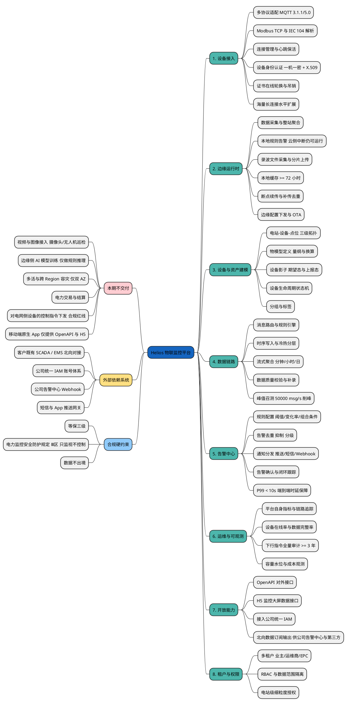

# Phase 1 产出 · 能力全景分解

> 项目：**Helios —— 分布式光伏与储能电站物联监控平台**
> 输入依据：`design/00-constraints.md` v1
> 使用 skill：`mindmap`（PlantUML `@startmindmap`）
>
> ⚠️ 本项目为 playbook 流程验证用途，约束为虚构但自洽。

---

## 1. 能力全景脑图

右侧为**本期交付能力**（8 个域），左侧为**本期不交付**与**外部依赖系统**。

约束清单第 8 节的 6 条排除项全部出现在左侧并标注，未凭空消失——这是 Phase 1 的退出标准之一。

---

## 2. 能力域清单（供 Phase 2 逐项归属）

Phase 2 的架构决策必须能覆盖下表每一项。若某项在 `02-decisions.md` 里找不到归属，即为 Phase 6 审查要报的"无落点能力"。

| # | 能力域 | 关键子能力 | 主要非功能驱动 | 本期 |
|---|---|---|---|---|
| 1 | 设备接入 | 多协议、认证、证书轮换、长连接扩展 | 50 万站 / 峰值 50,000 msg/s | ✅ |
| 2 | 边缘运行时 | 采集聚合、本地告警、72h 缓存、补传 | 边缘自治（硬约束） | ✅ |
| 3 | 设备与资产建模 | 三级拓扑、物模型、设备影子、状态机 | 2000 万点位建模 | ✅ |
| 4 | 数据链路 | 路由、时序冷热分层、流式聚合、削峰 | 13 个月原始 / 5 年聚合；峰值削峰 | ✅ |
| 5 | 告警中心 | 规则、去重抑制、分发、闭环 | P99 < 10s | ✅ |
| 6 | 运维与可观测 | 平台监控、在线率、审计 | 审计 ≥ 3 年 | ✅ |
| 7 | 开放能力 | OpenAPI、H5 接口、IAM 接入、北向数据订阅输出 | 对接 4 个外部系统 | ✅ |
| 8 | 租户与权限 | 多租户、RBAC、电站级授权 | 多角色数据隔离 | ✅ |
| — | 视频/图像接入 | — | — | ❌ 排除 |
| — | 边缘 AI 训练 | — | — | ❌ 排除 |
| — | 多活容灾 | — | — | ❌ 排除 |
| — | 电力交易结算 | — | — | ❌ 排除 |
| — | 电网侧控制下发 | — | 合规红线 | ❌ 排除 |
| — | 原生 App | — | — | ❌ 排除 |

---

## 3. 分解粒度自检

按 playbook Phase 1 退出标准逐项核对：

- **粒度是否到"能独立判断本期做不做"**：是。例如"边缘侧 AI 模型训练"被排除，但"本地规则告警"保留——两者在同一个"边缘"话题下却被拆到了可独立取舍的粒度。
- **是否有兜底分类**：无"其他""杂项"节点。
- **排除项是否标注而非消失**：6 条全部在左侧 `本期不交付` 分支下，并同步进第 2 节清单。
- **是否与约束清单逐条对应**：第 4 节规模指标 → 能力域 1/4；第 5 节可用性 → 能力域 2（边缘自治）；第 6 节合规 → 左侧独立分支 + 能力域 6（审计）；第 9 节既有系统 → 左侧外部依赖分支 + 能力域 7。

---

## 4. 交给 Phase 2 的重点问题

脑图暴露出四个必须在架构决策阶段回答的问题，已在 Phase 2 委派 prompt 中点名：

1. **稳态 1,700 msg/s 与峰值 50,000 msg/s 相差 30 倍** —— 按峰值建常态资源会极度浪费，按稳态建会在召测时崩。削峰机制怎么设计？
2. **边缘自治是硬约束** —— 72h 本地缓存 + 云侧中断时本地告警仍运行，这决定了边缘网关不是一个"薄客户端"，需要独立的能力边界。
3. **2000 万点位 × 13 个月原始数据** —— 时序库选型与冷热分层的成本曲线是本项目最大的单项成本，需给出量化估算。
4. **告警 P99 < 10s 且需同时推 App/短信/公司告警中心** —— 告警链路能否与遥测链路共用同一条 Kafka 通道，还是必须物理隔离？

---

## 5. 修订记录

| 版本 | 修订内容 | 触发来源 |
|---|---|---|
| v1 | 初版 | Phase 1 |
| **v1.1** | **域 7 的"北向数据输出供 SCADA/EMS 消费"改为"北向数据订阅输出，供公司告警中心与第三方"** | `Plan` agent 在 Phase 2 报为待拍板 #7：本条与约束清单第 9 节方向相反——约束说平台是 SCADA/EMS 的**数据消费方**（经边缘 Modbus TCP / IEC 104 读取），本文件却写成平台向 SCADA/EMS **输出**。已按约束清单为准修正。SCADA/EMS 作为上游数据源，其协议解析归属域 1（多协议适配）与域 2（边缘运行时），不在域 7。 |

### 第 4 节问题的 Phase 2 回答情况

四个问题在 `design/02-decisions.md` 中的处置：

| # | 问题 | Phase 2 结论 |
|---|---|---|
| 1 | 30 倍峰谷差如何削峰 | 已答（3.1）——核心是**分流**而非扩容：召测波形直传 OSS 不入时序库，broker+Kafka 硬建、TSDB 按稳态建 |
| 2 | 边缘自治对能力边界的要求 | 已答（4.2）——边缘不是薄客户端，列出 8 项必备能力与云边协议清单 |
| 3 | 时序库冷热分层成本 | **前提被推翻**（3.2）——按 11 MB/站/日 推算，最大单项成本是录波文件的 OSS（≈2.1 PB），不是时序库容量（13 个月仅 7~23 TB），两者相差约两个数量级 |
| 4 | 告警与遥测能否共用 Kafka | 已答（4.3）——**不能**，必须双集群物理隔离，理由含 page cache 与磁盘调度无法用 quota 隔离 |

> 问题 3 的前提被下游阶段推翻，是**正常且有价值**的结果——说明 Phase 1 提出的问题质量足够，也说明 Phase 2 做了真实计算而非顺着假设走。但同时也暴露：约束清单第 4 节的"单站日增 11 MB"缺少"文件 vs 结构化遥测"的构成拆分，这个缺口已登记为 `02-decisions.md` 待拍板 #2。
